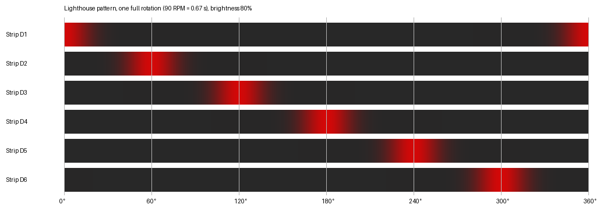

# Redlight – ESP32 goal light

Firmware to bring a dead light-tower goal light (like the Bud Light Red Light)
back to life with a **Seeed XIAO ESP32-C6**. When one of your favorite NHL
teams scores, it fires the tower's lights in sequence to make the rotating
strobe and plays a horn/siren through the original speaker. It runs off a **wall power supply** instead of
batteries, and there's no phone app: everything is set up from a web page the
light serves itself.

* Polls the public NHL score feed (`api-web.nhle.com`), every 5 s during
  your teams' games and slower otherwise
* Pick any number of favorite teams
* **TV delay** setting so the light goes off when *you* see the goal, not
  30 s early
* Plays your own `horn.wav` (upload it from the browser), or a built-in
  synthesized horn + siren if none is installed
* Goals that are overturned on review are handled, and goals scored
  before power-up are ignored
* Light patterns: **Lighthouse** (default: a narrow beam sweeps around the
  tower, one bank flashing after another), **Spin** (softer, with a fading
  tail), **Chase**, **Strobe**, **Alternate**, with adjustable speed and brightness

  
* The housing's original buttons: TEST to test/stop (hold 10 s to reset
  WiFi), VOL+ / VOL- to change the volume

Hardware and wiring: **[docs/WIRING.md](docs/WIRING.md)**

## Flash from a browser (no install)

`firmware/redlight-xiao-c6-full-0x0.bin` is a ready-built image for the Seeed
XIAO ESP32-C6 (bootloader, partition table and firmware in one file). Each
file name ends with the flash address it must be written to.

1. Download the file, and plug the XIAO into a computer with a USB-C **data** cable.
2. In Chrome or Edge, open <https://espressif.github.io/esptool-js/>.
3. Click **Connect** and pick the XIAO's serial port ("USB JTAG/serial debug unit").
4. Set **Flash Address** to `0x0`, choose the file, and click **Program**.
5. When it finishes, unplug and replug the XIAO (or press its reset button).

**Updating a board that is already set up:** flash
`redlight-xiao-c6-update-0x10000.bin` at address **`0x10000`**
instead. That replaces only the firmware and keeps your WiFi and settings; the
full image at `0x0` erases them. An update file written to `0x0` by mistake
overwrites the bootloader ("Invalid image block, can't boot"); flash the full
image at `0x0` to recover.

If no port shows up, or the board keeps resetting, hold the XIAO's **BOOT**
button while plugging it in.
The image is rebuilt by hand, so it can lag behind the source; build with
PlatformIO (below) after changing any code.

## Build & flash

Install [PlatformIO](https://platformio.org/install) (VS Code extension or CLI), then:

```bash
pio run -e xiao_c6 -t upload     # Seeed XIAO ESP32-C6 (the board on the tower PCB)
pio run -e esp32c6 -t upload     # ESP32-C6 DevKitC-1
pio device monitor               # serial log
```

If upload won't start, hold **BOOT** while plugging in USB.

The build uses USB-CDC for `Serial` (right for XIAO boards). On a board whose
USB goes through a UART chip, remove `-D ARDUINO_USB_CDC_ON_BOOT=1` to see logs.

## First-time setup

1. Power it up. It creates a WiFi network called **`GoalLight-Setup`**.
2. Join it from your phone. A captive portal opens (if not, browse to
   `192.168.4.1`). Choose your home WiFi and enter the password.
3. It reboots and joins your network. Open **http://goallight.local**
   (or the IP printed on the serial monitor / shown in your router).
4. Tick your teams, set the TV delay, and hit **Save**. Press **Test goal**.

## The horn sound

The original sound lived on the fried board, so you'll need to supply one:
a recording of a goal horn, your team's arena horn + goal song, etc. Convert
it and upload from the web page:

```bash
./tools/make_horn.sh goal-horn.mp3          # -> horn.wav (needs ffmpeg)
```

Any **16-bit PCM WAV** (mono or stereo, any sample rate) works. The filesystem
holds about 2 MB, roughly 45 s at the script's 22 kHz mono. The horn plays once
per goal, and the lights run for the **Light duration** setting.

## Syncing to your TV

Cable/satellite is typically 5–15 s behind the live feed and streaming
30–60 s or more. Leave the delay at 0 for one game and time how long it is
from the light going off to seeing the goal on your TV. Put that number in
**TV / stream delay**.

## Project layout

```
src/config.h      pins and defaults
src/main.cpp      WiFi setup, button, main loop
src/nhl.cpp       NHL score polling + goal detection
src/tower.cpp     light sequencing / patterns (runs in its own task)
src/celebrate.cpp goal celebration, WAV player, synth siren
src/web.cpp       settings page, status, WAV upload
src/settings.cpp  settings stored in flash (NVS)
docs/WIRING.md    parts list and schematic
tools/make_horn.sh audio conversion helper
```
