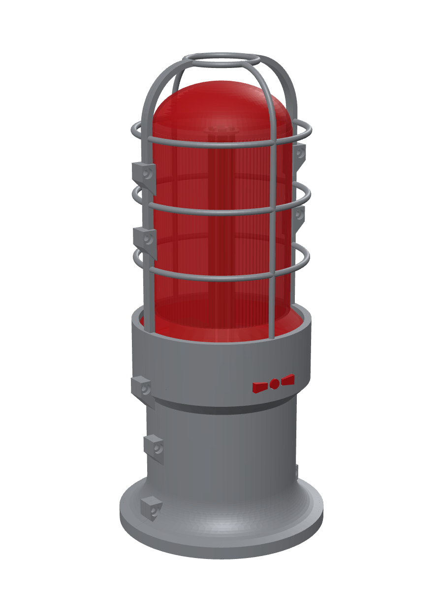
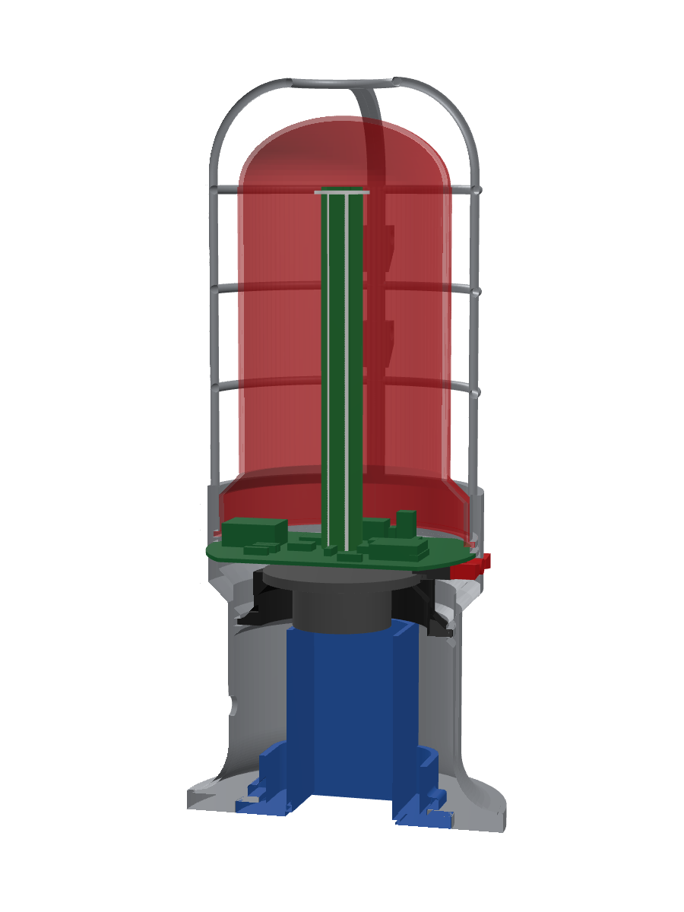

# Printed housing for the replicas

Everything around the tower PCB for the four new lights: two shell halves
with the guard cage built in, the red globe, the speaker cup and the button
plungers. `housing.py` builds them all; `fit_check.py` puts the whole light
together (PCB, tower, strips, battery insert, speaker) and checks that nothing
runs into anything.

 

It follows the original's size and shape (300 mm tall, 134 mm foot, 97 mm
neck, 114 mm collar band, 111 mm cage, all MEASURED), with our own details:
no emblem plate, a bow-tie button on the front (VOL+ / TEST / VOL−), printed
lugs on the seam for M3 screws, and a hole in the back for the barrel jack.

## Parts per light

| File | Print | Notes |
|---|---|---|
| `out/housing_front.stl` | 1 | front half (buttons) |
| `out/housing_back.stl` | 1 | back half (barrel jack, heat-set inserts) |
| `out/globe.stl` | 1 | translucent red PETG |
| `out/speaker_cup.stl` | 1 | holds the 64 mm speaker face up |
| `out/button_test.stl`, `button_vol_plus.stl`, `button_vol_minus.stl` | 1 each | |
| `../tower/out/tower_core.stl` | 1 | |
| `../insert/out/RedLight_Insert_rev07.stl` | 1 | battery insert, unchanged |

Hardware per light: 10 × M3 × 12 mm socket-head screws, 10 × M3 heat-set inserts
(4.2 mm hole, ≤ 5 mm long), a panel-mount 5.5 × 2.1 mm barrel jack with an M8
thread, and a 4 Ω 3 W, 64 mm speaker.

## Printing (Bambu H2S)

**Halves**: grey or silver PETG, **standing upright** on the foot (300 mm
tall, which fits the H2S's 340 mm). Upright, the outside is smooth and the
grooves and lugs print without support.
* Tree supports, for the cage rings, the arcs at the top and the small
  ledge of the bottom plate over the insert recess. Everything else is ≤ 45°.
* 4 walls, 15 % gyroid, 0.2 mm layers. Slow the outer wall above the collar:
  the cage bars are 3.65 mm and 165 mm tall. A brim helps keep the half from
  rocking.

**Globe**: translucent red PETG, **flange down**. The skirt, the 45° taper and
the ribbed cylinder print without support. The rounded top flattens out near
the apex, so paint supports onto just the inside of the top 10 mm or so.
Vase mode won't work (the flange and ribs need more than one wall). A matte
or textured plate makes the flange face frosted, which doesn't matter.

**Speaker cup**: rim down, no support. **Buttons**: on their side, no support.
**Tower core**: flange down (see `cad/tower/README.md`).

## Assembly

1. Press the 10 heat-set inserts into the back half's lugs.
2. Glue the speaker into the cup's top recess, face up, wires out through the
   notch. Fit the barrel jack in the back half.
3. Drop the button plungers into the front half's bow-tie from the inside,
   stop plates against the wall.
4. Lay the back half on its seam face: speaker cup rim into the lower groove
   (wire notch toward the back), the tower PCB into its groove (the flats sit
   on the keys at the seam, so it only goes in one way, switches toward the
   front), the globe's flange into the groove just above it.
5. Close the front half and screw the halves together.
6. Snap the battery insert into the bottom.

**Volume button direction:** the board puts VOL+ on the left as you face
the front. If you'd rather have + on the right, swap the two in the firmware's
button handling rather than moving parts.

## What's measured and what's assumed

* MEASURED: overall height, foot, neck, collar, cage diameters, foot height,
  PCB groove at 112 mm, 37 mm from the speaker groove to the PCB groove, cup
  rim 91.5 mm, cup 22.8 mm tall, 64 mm speaker, globe 170 mm tall, 86 mm
  cylinder, 109 × 2.1 mm flange, 100 mm inside above the flange for 17.4 mm,
  cage bars 3.65 mm, rings 40 mm apart, wall 2.1 mm.
* Changed on purpose: the speaker groove is at 80 mm (the original's is at
  75 mm) so the battery insert's top clears the cup. The wall is 2.4 mm, for
  six perimeters.
* Assumed: the globe's rounded top is 28 mm tall, its wall is 2 mm, 120 ribs.
  The switch actuators are 3.5 mm under the board. `fit_check.py` passes with
  these.
