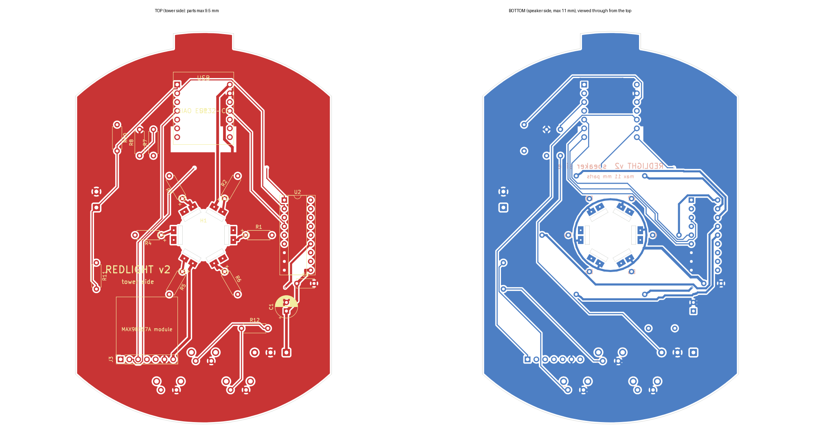

# Replacement tower PCB (v2)

Drop-in replacement for the original "Red Light 2.0" board: same outline
(109.5 mm circle, 74.15 mm across the flats), a 4.2 mm tower screw hole, and
six slots for the 5.15 mm LED strip tabs.

The speaker sits only 11 mm below the board, so all tall parts go on the
**tower side**, which is hidden inside the housing. On that side the red glass
necks down to ~82 mm inside diameter 13 mm above the board, so anything
outside r = 41 mm is kept under 12 mm (`fit_stl.py` checks this). The tallest
part is the XIAO at ~9.5 mm. The speaker side carries
only the angled TEST switch (~4 mm) and solder pads for wires.



## Files

| File | What |
|---|---|
| `redlight-gerbers.zip` | upload this to JLCPCB / PCBWay / OSH Park |
| `redlight.kicad_pcb` | KiCad board (opens in KiCad 7, 8, 9) |
| `out/redlight_fit.stl` | printable fit model (tower-side parts as blocks of real size/height) |
| `make_pcb.py` | generates the board: outline, slots, placement, nets |
| `route.py` | autoroutes (Freerouting), pours ground, DRC, Gerbers |
| `fit_stl.py` | builds the fit model from the board |

There's no schematic sheet. The netlist is defined in `make_pcb.py`, and
`docs/WIRING.md` has the circuit.

## Ordering

2 layers, 1.6 mm, any color, HASL (lead-free is fine), 1 oz copper.
The six tab slots and the screw hole are cut from the Edge.Cuts outline
(non-plated), which every fab handles at no extra cost. Leave other options
at their defaults.

## Parts (BOM)

| Ref | Part | Notes |
|---|---|---|
| U1 | Seeed XIAO ESP32-C6 | on 2× 1x7 **low-profile** female headers (≤ 5 mm), or soldered straight onto male pins. Standard 8.5 mm sockets are too tall for the glass |
| U2 | TBD62083APG | DIP-18, in a DIP-18 socket. ULN2803A also fits (dimmer) |
| R1–R6 | wire jumpers (0 Ω) | each strip has its own 20 Ω resistor ("200"). Use a clipped lead; the pads take a 1/4 W axial resistor if you ever want to dim a strip |
| R7, R8 | 100 kΩ 1/4 W axial | battery gauge divider |
| C1 | 220 µF 10 V electrolytic, 6.3 × 7 mm, 2.5 mm pitch | watch polarity |
| C2 | 100 nF ceramic, 5 mm pitch | |
| J1 | solder pads, 3-way (speaker side) | 5V / GND / VBAT wires from the UPS module + cells |
| J2 | solder pads, 2-way (speaker side) | optional external TEST button |
| J3 | (holes only) | MAX98357A breakout soldered straight on its 1x7 male header, components facing away |
| SW1–SW3 | PTS645 right-angle 6 mm tact switch (speaker side) | TEST, VOL+, VOL- at the housing's buttons |
| R10, R11, R12 | 10 kΩ, 2.2 kΩ, 6.8 kΩ 1/4 W axial | button resistor ladder |
| — | MAX98357A breakout (Adafruit 3006 or clone) | **leave the screw terminal off**; solder the speaker wires to its + / − pads |

## Before ordering

- [x] Flat fit print: outline, tab slots, screw hole
- [x] Fit print v3 (no support tab): outline, slots, screw hole, parts clearance
- [ ] v2 fit print: tower-side parts clear the dome, tab sits in the recess
- [x] Tab thickness 1.0 mm, width 5.15 mm, 14.4 mm across strip faces
- [x] "+" is the counter-clockwise half of each tab from the tower side (checked on the fit print)
- [x] Button positions (TEST 39.6 mm, VOL± 48 mm and 20.15 mm apart)
- [x] Strips run on 5 V (very bright on the bench supply); worst case ~160 mA each

To regenerate after a change:

```bash
python3 cad/pcb/make_pcb.py
FREEROUTING_JAR=~/freerouting-1.9.0.jar python3 cad/pcb/route.py   # needs Java (+ xvfb-run on headless Linux)
python3 cad/pcb/fit_stl.py
```
