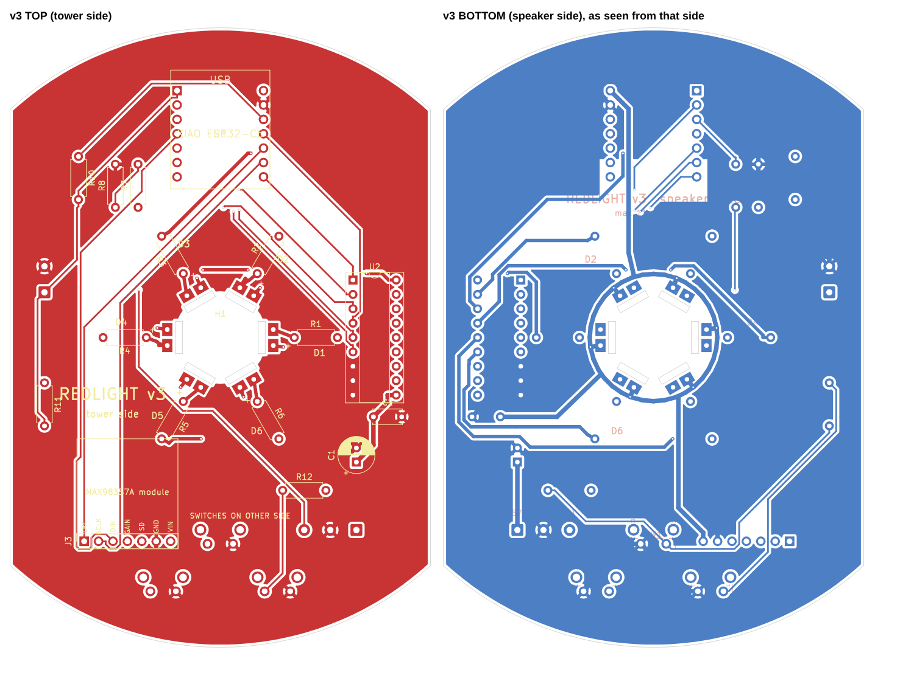
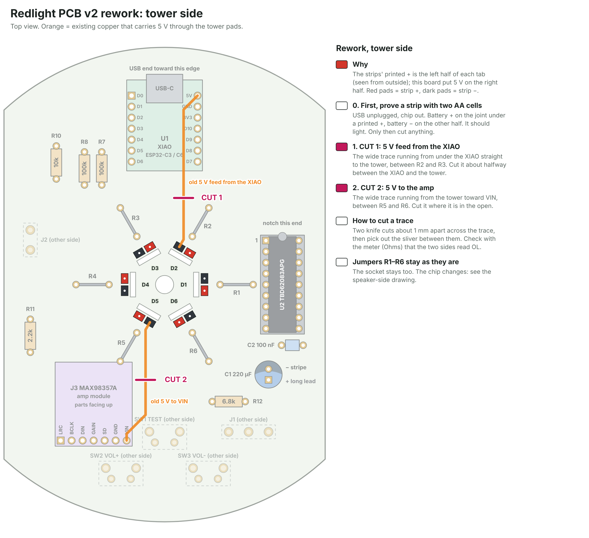
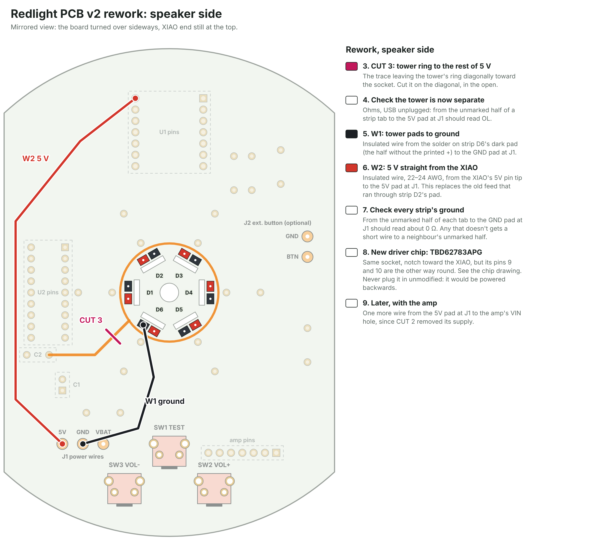
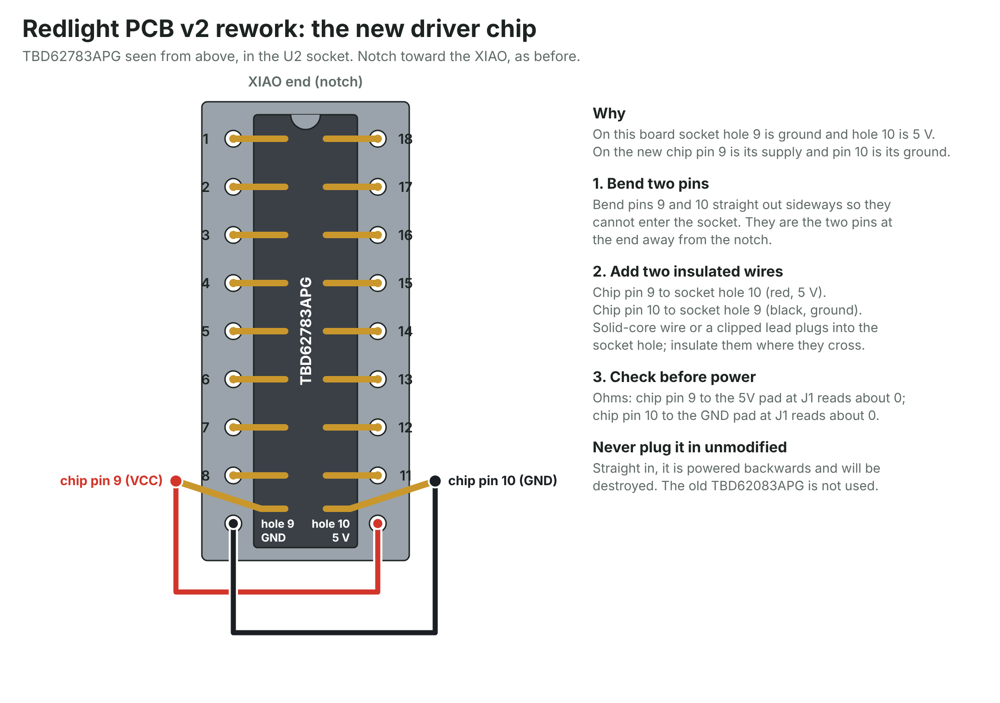
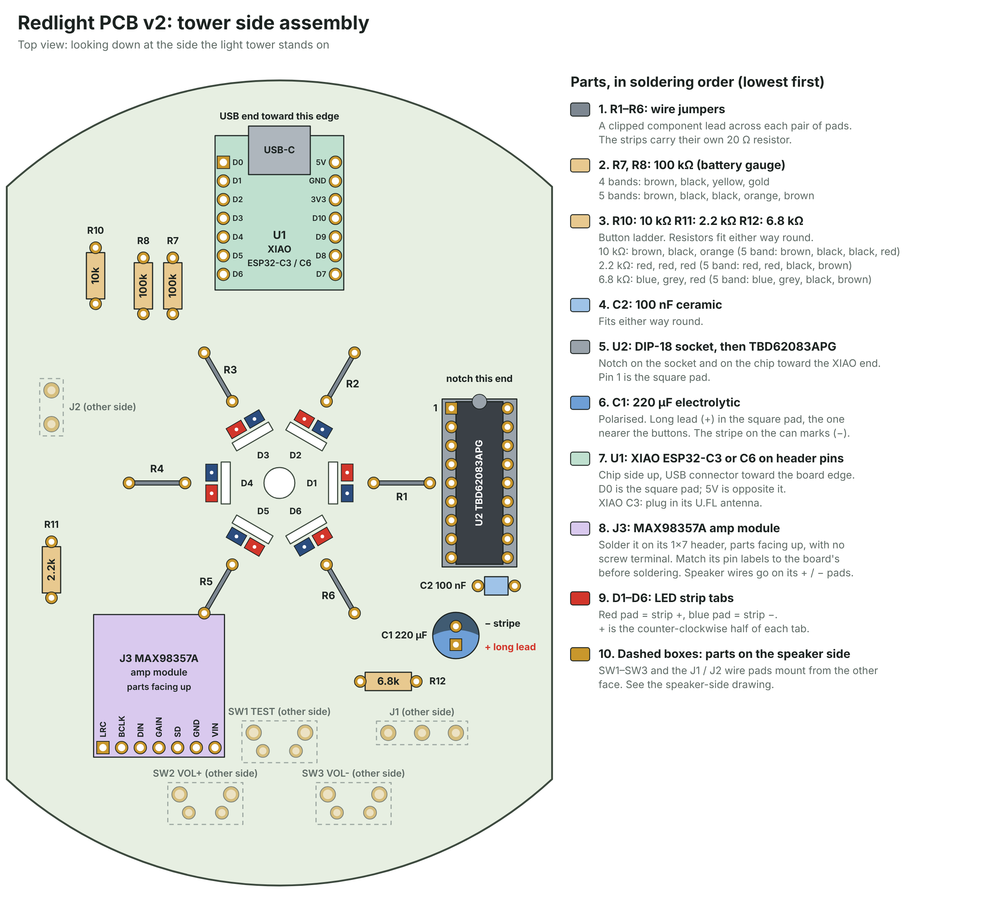
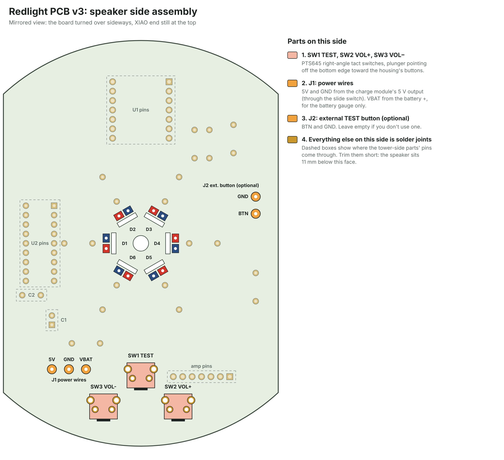

# Replacement tower PCB (v2)

Drop-in replacement for the original "Red Light 2.0" board: same outline
(109.5 mm circle, 74.15 mm across the flats), a 4.2 mm tower screw hole, and
six slots for the 5.15 mm LED strip tabs.

The speaker sits only 11 mm below the board, so all tall parts go on the
**tower side**, which is hidden inside the housing. On that side the red glass
necks down to ~82 mm inside diameter 13 mm above the board, so anything
outside r = 41 mm is kept under 12 mm (`fit_stl.py` checks this). The tallest
part is the XIAO at ~9.5 mm. The speaker side carries
only the angled TEST switch (~4 mm) and solder pads for wires.



## Known issues on v2 boards

**The strip-tab pads are swapped.** The strips' printed "+" is the clockwise
half of each tab seen from the tower side (the left half, seen from outside the
tower). The v2 board puts +5V on the counter-clockwise half, so strips soldered
in as-is are reverse-biased and never light. Two ways to fix a built board:

1. **Turn each strip end for end**, if its top-end pads fit the slot. That swaps
   left and right, so the printed "+" lands on the board's "+" pad. Check with a
   meter whether the top pads sit behind the strip's own 20 Ω resistor; if they
   bypass it, fit 20–22 Ω resistors at R1–R6 in place of the jumpers.
2. **Rework the board for a source driver** (`rework.py`, drawings below): three
   trace cuts make the tower's common pads ground, and a TBD62783APG with pins
   9 and 10 crossed over feeds 5 V to each strip. Firmware is unchanged.

**The 5 V feed runs through strip D2's tab pad.** The only copper from the XIAO's
5V pin to the rest of the board passes through that pad's small plated hole. On
the first build it measured as a high-resistance joint (5 V at the XIAO, 1.8–4.7 V
at J1). Add an insulated wire on the speaker side from the XIAO's 5V pin to the
5V pad at J1; it is "W2" on the rework drawing and needs no cuts.

A v3 board should set `PLUS_ON_CCW_SIDE = False` in `make_pcb.py` and route 5 V
to J1 without passing through a tab pad.







## Assembly drawings

Where every part goes, with orientation notes and a soldering order:





## Files

| File | What |
|---|---|
| `redlight-gerbers.zip` | upload this to JLCPCB / PCBWay / OSH Park |
| `redlight.kicad_pcb` | KiCad board (opens in KiCad 7, 8, 9) |
| `out/redlight_fit.stl` | printable fit model (tower-side parts as blocks of real size/height) |
| `make_pcb.py` | generates the board: outline, slots, placement, nets |
| `route.py` | autoroutes (Freerouting), pours ground, DRC, Gerbers |
| `fit_stl.py` | builds the fit model from the board |
| `assembly.py` | draws the assembly drawings from the board file (no KiCad needed) |
| `rework.py` | draws the rework for v2 boards (swapped tab pads, see Known issues) |

There's no schematic sheet. The netlist is defined in `make_pcb.py`, and
`docs/WIRING.md` has the circuit.

## Ordering

JLCPCB settings that were checked for this board: FR-4, 2 layers, 1.6 mm,
1 oz, HASL, tented vias, 0.3 mm min via, ±0.2 mm outline tolerance, single
PCB, no assembly. Color is free choice. The six tab slots are 5.7 × 1.25 mm;
the extra length covers the router's rounded slot ends.

2 layers, 1.6 mm, any color, HASL (lead-free is fine), 1 oz copper.
The six tab slots and the screw hole are cut from the Edge.Cuts outline
(non-plated), which every fab handles at no extra cost. Leave other options
at their defaults.

## Parts (BOM)

| Ref | Part | Notes |
|---|---|---|
| U1 | Seeed XIAO ESP32-C3 or ESP32-C6 | flash the matching firmware (`xiao_c3` / `xiao_c6`); the C3 needs its U.FL antenna. On 2× 1x7 **low-profile** female headers (≤ 5 mm), or soldered straight onto male pins. Standard 8.5 mm sockets are too tall for the glass |
| U2 | TBD62083APG | DIP-18, in a DIP-18 socket. ULN2803A also fits (dimmer) |
| R1–R6 | wire jumpers (0 Ω) | each strip has its own 20 Ω resistor ("200"). Use a clipped lead; the pads take a 1/4 W axial resistor if you ever want to dim a strip |
| R7, R8 | 100 kΩ 1/4 W axial | battery gauge divider |
| C1 | 220 µF 10 V electrolytic, 6.3 mm dia, 2.5 mm pitch, up to 6.3 × 11 mm | e.g. Rubycon 10YXS220MEFC6.3X11 (Digi-Key 1189-10YXS220MEFC6.3X11-ND). Sits inside the glass neck, so 12.5 mm tall is fine. Watch polarity |
| C2 | 100 nF (0.1 µF) ceramic, 50 V, 5.08 mm pitch | e.g. KEMET C322C104K5R5TA. The C320C104K5R5TA (Digi-Key 399-4264-ND) also works with its 2.54 mm leads spread slightly |
| J1 | solder pads, 3-way (speaker side) | 5V / GND / VBAT wires from the UPS module + cells |
| J2 | solder pads, 2-way (speaker side) | optional external TEST button |
| J3 | (holes only) | MAX98357A breakout soldered straight on its 1x7 male header, components facing away |
| SW1–SW3 | PTS645 right-angle 6 mm tact switch (speaker side) | TEST, VOL+, VOL- at the housing's buttons |
| R10, R11, R12 | 10 kΩ, 2.2 kΩ, 6.8 kΩ 1/4 W axial | button resistor ladder |
| — | MAX98357A breakout (Adafruit 3006 or clone) | **leave the screw terminal off**; solder the speaker wires to its + / − pads |

## Final check (before ordering)

* Netlist dumped from the board and compared against the firmware pin map
  (`src/config.h`): every XIAO pin, lights 1-6 in order around the tower,
  I2S, button ladder, battery sense.
* XIAO ESP32-C6 D-pin to GPIO mapping and TBD62083APG pinout (pin 9 GND,
  pin 10 COMMON) confirmed against published pinouts / the Toshiba datasheet.
* DRC: no copper errors, no unconnected pads. Fit prints checked in the housing.
* Not verifiable here: the MAX98357A module's orientation on J3. J3 has the
  pin names printed beside it; line them up with the module's labels before
  soldering (mount it upside down if that's what makes them match).

## Before ordering

- [x] Flat fit print: outline, tab slots, screw hole
- [x] Fit print v3 (no support tab): outline, slots, screw hole, parts clearance
- [ ] v2 fit print: tower-side parts clear the dome, tab sits in the recess
- [x] Tab thickness 1.0 mm, width 5.15 mm; strip inside faces 13.6 mm across (slot centers at r = 7.3 mm)
- [x] ~~"+" is the counter-clockwise half of each tab from the tower side~~ **Wrong:** the strips' printed "+" is the clockwise half. See Known issues
- [x] Button positions (TEST 39.6 mm, VOL± 48 mm and 20.15 mm apart)
- [x] Strips run on 5 V (very bright on the bench supply); worst case ~160 mA each

To regenerate after a change:

```bash
python3 cad/pcb/make_pcb.py
FREEROUTING_JAR=~/freerouting-1.9.0.jar python3 cad/pcb/route.py   # needs Java (+ xvfb-run on headless Linux)
python3 cad/pcb/fit_stl.py
```
