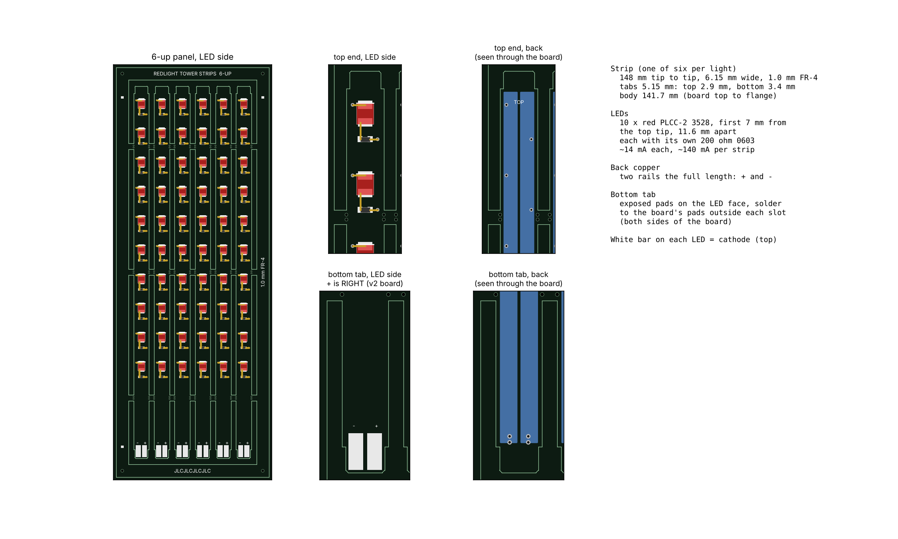

# Tower LED strips (for the v2 board)

New strips to replace the original six per tower, made as a 6-up panel that
JLCPCB fabricates and assembles. One panel is one light.

## The strip

Copies the original's outline (MEASURED): 148 mm tip to tip, 6.15 mm wide,
1.0 mm thick, with a 5.15 mm tab at each end. The bottom tab is 3.4 mm long
(1.6 mm board + 1.8 mm out the other side), the top one 2.9 mm (1.4 mm flange +
1.5 mm out), leaving 141.7 mm of body between the PCB and the core's flange.

* **LEDs:** 10 red PLCC-2 (3528), the first 7 mm from the top tip, then every
  11.6 mm, the same as the original.
* **Current:** each LED has its own 200 Ω resistor (the original had one
  20 Ω resistor for all ten in parallel). About 14 mA per LED, 140 mA per
  strip, the same as the original's 150 mA, so the firmware, driver chip and
  power budget don't change.
* **Back:** two copper rails the full length, + and −.
* **Bottom tab:** exposed pads on the LED face. They solder to the board's
  pads on the outside of each slot.

## Polarity: made for the v2 board

Seen from outside the tower, with the LEDs facing you and the bottom tab
down, **"+" is the right half of the tab** (printed beside the pads). That's
where the v2 board has its 5 V ring, and it's the reverse of the original
strips. So a fresh v2 board needs **none of the polarity rework**: no trace
cuts, and no TBD62783APG with crossed pins. Fit the stock **TBD62083APG** as
designed.

For a v3 board, set `PLUS_ON_RIGHT = False` in `make_strip.py` and rebuild.

## Building a fresh v2 board with these strips

1. Assemble the board as drawn in `cad/pcb/out/assembly_*.png`, with the
   TBD62083APG notch toward the XIAO. **Do not** do the cuts, the W1 wire or
   the chip swap from `rework.py`.
2. **Do add W2**, the wire from the XIAO's 5V to J1 5V (`cad/pcb/out/rework_tower_side.png`).
   On v2 the 5 V feed passes through strip D2's tab pad, and that joint was
   unreliable on the first build.
3. Put the six strips on the core (top tabs through the flange), lower the
   assembly onto the board with the bottom tabs in the slots, then fit the screw.
4. Solder each tab on **both** sides of the board. On the first build, three
   pads' plated holes didn't join the two sides, and solder on both sides
   gets around that.
5. Check with **Test lights only** → Chase before closing it up.

## Ordering (JLCPCB)

Files are in `fab/`, made by `python3 cad/strip/make_strip.py`.

**PCB**: upload `redlight-strip-gerbers.zip`.

| Setting | Value |
|---|---|
| Layers | 2 |
| Dimensions | 60.9 × 163 mm (read from the Gerbers) |
| Quantity | **5** panels = 30 strips: four lights plus six spares |
| Delivery format | **Panel by Customer** (the panel is already drawn: 6 strips, frame, mouse bites) |
| Thickness | **1.0 mm** (the board and flange slots are sized for 1.0 mm tabs) |
| Mask colour | white reflects the most light inside the dome; any colour works |
| Surface finish | HASL lead-free, or ENIG |

**PCB assembly**: top side, Economic, quantity 5, tooling holes "Added by
Customer" (they're in the frame). Upload `strip_bom.csv` and `strip_cpl.csv`.

* **The LED has no part number in the BOM.** In the parts-matching step,
  search JLCPCB's library for a red PLCC-2 3528 LED (or "3528 red") rated
  20 mA or more and pick an in-stock one. The pads take any 3.5 × 2.8 mm
  PLCC-2.
* The resistor is listed as C8218 (200 Ω 0603). Check that the match comes up
  as 200 Ω 0603 before ordering.
* **In the placement preview, check the LED polarity.** On every strip the
  cathode (the part's marked corner or notch) must point to the **top end**,
  away from the bottom tab's pads. If JLCPCB's model shows them reversed, rotate
  the LEDs 180° there. The pads are symmetrical, so that's the whole fix.

After delivery, snap the strips out and file or sand the mouse-bite nubs flush
on their long edges.

## Files

| File | What |
|---|---|
| `make_strip.py` | generates the panel, fills the copper, runs DRC, writes `fab/` |
| `redlight_strip_panel.kicad_pcb` | the panel (KiCad 7+) |
| `fab/redlight-strip-gerbers.zip` | PCB order |
| `fab/strip_bom.csv`, `fab/strip_cpl.csv` | assembly order |
| `preview.py` → `out/strip_preview.png` | the picture above |
