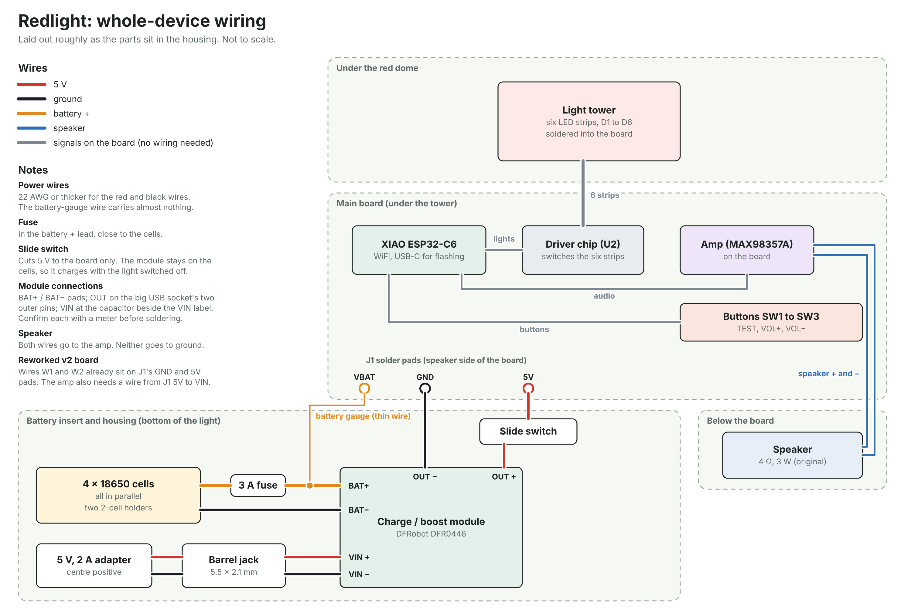

# Wiring the housing

Gut the old board completely. You keep the **light tower** (six LED strips,
fired in sequence to make the rotating strobe), the **speaker**, and the shell.
It runs on four 18650 cells in parallel, charged through the panel-mount barrel
jack, in place of the old D cells.



(`tools/wiring_diagram.py` redraws this.)

## Power

```
5 V adapter ─► barrel jack ─► charge/boost module ─► slide switch ─► 5V pad at J1
                                     │
                       4× 18650 in parallel, 3 A fuse in the + lead
                                     │
                              battery + ─► VBAT pad at J1 (battery gauge)
```

The module is a **DFRobot DFR0446** (MP2636, 5 V out, listed at 2.5 A). Its
input and output are on USB sockets, so the wires solder to the board itself:

| Connection | Where on the module | Goes to |
|---|---|---|
| Battery + and − | **BAT+** and **BAT−** pads beside the white socket | the cells (fuse in the + lead) |
| 5 V output | the two **outer** pins of the big USB socket, on the back | + through the slide switch to **5V** at J1; − to **GND** at J1 |
| 5 V input | the capacitor beside the **VIN** label | barrel jack + |
| Input ground | either large round pad on the back (the USB socket's shell) | barrel jack − |
| Battery gauge | **BAT+** pad | **VBAT** at J1 |

Confirm the output polarity and the VIN point with a meter before soldering:
the outer USB pin that reads 0 Ω to BAT− is ground, and with a charger plugged
into the micro-USB socket the VIN end of the capacitor reads 5 V.

**Check the module on the bench before building it in.** With one charged cell
on BAT+ / BAT−, the output should read about 5 V and still be on after three
minutes with nothing connected; with a charger plugged into the micro-USB, the
output should stay at 5 V while the CHG light is on. A module that switches
its output off in either case is the wrong kind for this light.

Use a **5 V 2 A** wall adapter with a 5.5×2.1 mm plug, center positive. The
slide switch only cuts 5 V to the board; the module stays on the cells, so it
charges with the light switched off.

**Measure the pack before connecting it.** It must read no more than 4.2 V. A
pack that reads around 8 V has cells in series; it will destroy the module and
overdrive the battery-sense pin.

**Cells: check before paralleling.**
* Only use cells that rest at **≥ 3.0 V** and have no dents, rust or
  swelling. Recycle anything below ~2.5 V.
* Charge each one on its own, let it rest, and recheck. Recycle any that sag
  well below the others (high self-discharge).
* Bring all four to within **0.05 V** of each other before connecting them
  in parallel. Otherwise the fullest cell dumps current into the emptiest.
* Use holders or spot-welded nickel strip, and keep the cells away from the
  speaker magnet and sharp edges. Don't solder directly to the cells.
* Put a **3 A fuse** on the pack's + lead, close to the cells.

## The tower

Six rigid LED strips, one per face of the hex core. Each strip is
independent, with **+** and **−** pads at the bottom; "+" is printed on the
strip, on the left half of the tab seen from outside the tower. The bottom
tabs pass through slots in the board and are soldered there.

Each strip is ten red LEDs in parallel behind its own 20 Ω resistor (marked
"200"), drawing about 150 mA at 5 V. Only the bottom pads power the whole
strip; the pads at the top end do not.

The board ties every strip's **+** to the 5 V rail and switches each strip's
**−** to ground with one channel of a low-side driver. R1–R6 on the board are
wire jumpers.

(A built **v2** board has the two tab pads swapped and is reworked to drive
the strips from the + side instead; see `cad/pcb/README.md`.)

## Parts

| Part | Notes |
|---|---|
| Seeed XIAO ESP32-C6 | on header pins, USB toward the board edge |
| TBD62083APG (DIP-18) | 8 low-side drivers, 500 mA each, takes 3.3 V logic directly. ULN2803A is a drop-in fallback (~1 V drop, a bit dimmer) |
| DIP-18 socket | so the driver chip can be swapped |
| MAX98357A I2S amp breakout | ~3 W into 4 Ω at 5 V, a match for the original 4 Ω 3 W speaker |
| 220 µF 10 V electrolytic, 100 nF ceramic | C1 and C2, across 5 V |
| DFRobot DFR0446 charge/boost module | see **Power** above |
| 4× 18650 in two 2-cell holders, 3 A fuse | holders wired in parallel |
| 2× 100 kΩ resistors | battery gauge divider |
| 10 kΩ, 2.2 kΩ, 6.8 kΩ resistors | button ladder (6.8 kΩ can be anything from 5.6 kΩ to 12 kΩ) |
| 3× PTS645 right-angle tact switches | TEST, VOL+, VOL−, on the speaker side of the board |
| 5 V 2 A adapter | 5.5×2.1 mm plug for the panel jack |

## Schematic

```
 5V (+) ──┬──────────┬──────────────┬─────────────────┬──────────────┐
          │          │              │                 │              │
       [220µF]   XIAO 5V       MAX98357A VIN    TBD62083APG     strips 1–6 (+)
          │                                    pin 10 (COM)
 GND ─────┴── GND ───┴── GND ───────┴── GND ── pin 9 (GND)

                     TBD62083APG
   LIGHT pin 1 ──► pin 1 (IN1)    pin 18 (OUT1) ──► strip 1 (–)
   LIGHT pin 2 ──► pin 2 (IN2)    pin 17 (OUT2) ──► strip 2 (–)
   LIGHT pin 3 ──► pin 3 (IN3)    pin 16 (OUT3) ──► strip 3 (–)
   LIGHT pin 4 ──► pin 4 (IN4)    pin 15 (OUT4) ──► strip 4 (–)
   LIGHT pin 5 ──► pin 5 (IN5)    pin 14 (OUT5) ──► strip 5 (–)
   LIGHT pin 6 ──► pin 6 (IN6)    pin 13 (OUT6) ──► strip 6 (–)
                   IN7/IN8 (pins 7–8) to GND, OUT7/OUT8 unconnected

   MAX98357A:  BCLK ← PIN_I2S_BCLK   LRC ← PIN_I2S_LRC   DIN ← PIN_I2S_DOUT
               GAIN: leave open (9 dB), or tie to GND for 12 dB if too quiet
               SD:   leave open
               OUT+ / OUT– → speaker (do NOT connect either one to GND)

   Buttons:    3V3 ─[10k]─ D0;  TEST: D0 to GND;  VOL+: D0 ─[2.2k]─ GND;
               VOL−: D0 ─[6.8k]─ GND

   Battery:    VBAT ─[100k]─ D2 ─[100k]─ GND
```

Same pinout as the ULN2803A (GND pin 9, COM pin 10). Check it against the
datasheet of the part you buy before soldering.

## Pin map (XIAO ESP32-C6)

| Signal | XIAO pin | GPIO |
|---|---|---|
| Light 1–6 | D7, D1, D6, D10, D4, D5 | 17, 1, 16, 18, 22, 23 |
| I2S BCLK | D8 | 19 |
| I2S LRC/WS | D9 | 20 |
| I2S DIN | D3 | 21 |
| Buttons (resistor ladder) | D0 | 0 |
| Battery sense | D2 | 2 |

* That uses all 11 pins. The pins skip the chip's boot-strapping pins, so a
  light driver can't stop the board from booting.
* **Button ladder:** the firmware tells TEST, VOL+ and VOL− apart by the
  voltage on D0.
* A light on GPIO 16 or 17 may flicker for a moment at power-up (those are
  the serial pins). That's harmless.

**The lights are wired 1…6 in order around the tower** so the spin turns
smoothly. If it goes the wrong way or jumps, rearrange the pin order in
`platformio.ini` instead of re-soldering:

```ini
[env:xiao_c6]
board = seeed_xiao_esp32c6
build_flags = ${env.build_flags} '-D LIGHT_PINS=23,22,18,16,1,17'
```

## Tips

* Power the XIAO from the module's 5 V output via its **5V pin**, not 3V3,
  and leave the XIAO's own BAT pads unconnected.
* Use **Test lights only** on the web page with the **Chase** pattern at
  ~20 RPM to check the order of each light.
